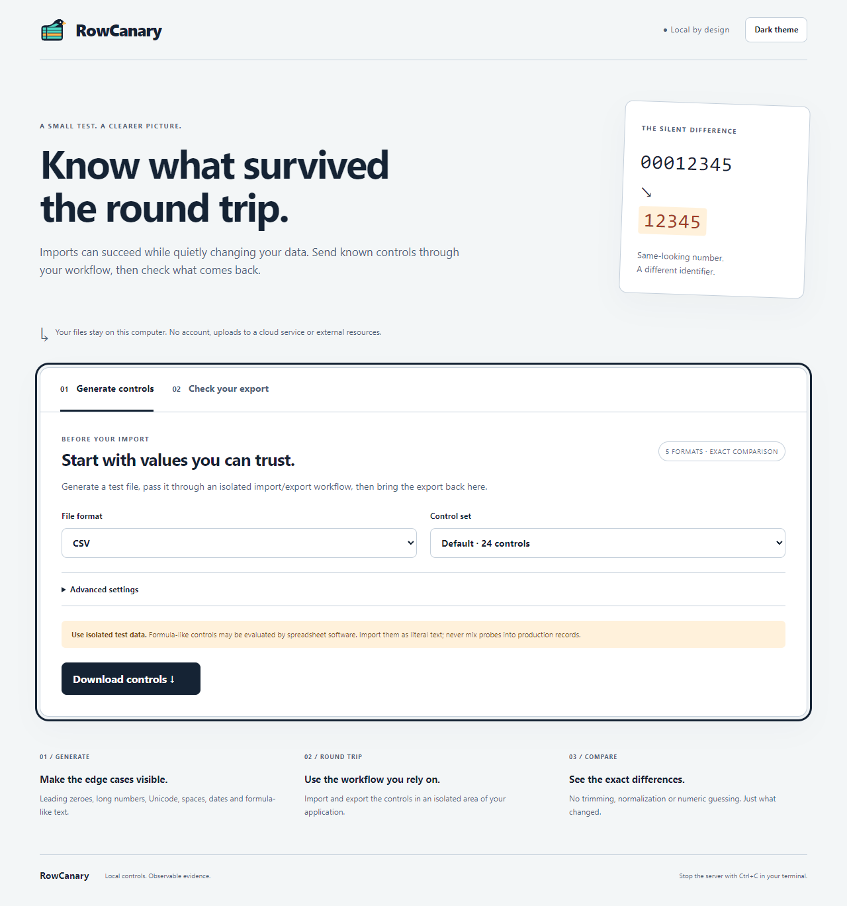
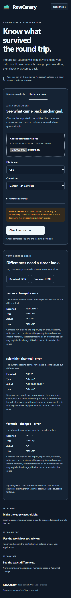

# Local browser interface

```bash
rowcanary serve --open
rowcanary serve --port 8766
```

Open the printed `http://127.0.0.1:PORT` URL. `--open` optionally launches your
default browser. Port 8765 is the default; `--port 0` chooses an available port.
Stop the server with Ctrl+C. The server binds to IPv4 loopback only. No public
host option, reverse proxy or remote access is supported. Use the printed IP URL,
not `localhost`, because the server checks the exact Host and Origin.

1. Generate controls. Choose CSV, TSV, JSON, JSONL or XLSX and the default,
   extended or custom-only control set. Advanced settings offer encoding and
   delimiters, plus a JSON array of additional custom controls.
   Leave encoding blank for UTF-8 generation and BOM-aware checking. Custom JSON
   goes directly to Python so integer digits are not rounded by JavaScript;
   use strings for decimal text whose formatting or precision must stay exact.
2. Import/export the file through an isolated area of the target application.
   Preserve the two control columns; import formula-like strings as literal text.
3. Select **Check your export**, choose the exported file, and use the same
   control set/custom values. Adjust renamed columns, encoding or delimiter if
   needed. Optionally require the original row order.
4. Read the counts and exact differences, then download JSON or standalone HTML.

The page has explicit labels, keyboard focus outlines, a skip link, an announced
status area and a light/dark theme button. It respects reduced-motion settings.
Theme preference is the only value stored in browser local storage.

All assets and operations stay on this computer. Inputs are sent to the local
Python process, decoded in a private temporary directory and removed after each
operation. Reports contain control values, so keep downloads private as needed.
The interface does not accept arbitrary local filesystem paths or output paths.
It does not retain an upload history. Browser download history/files follow your
browser's settings. Temporary files can remain after forced termination or a
machine crash; normal request completion removes them.

The page displays at most 200 diagnostic items and clearly marks larger results.
JSON/HTML downloads retain all items within the diagnostic safety limits; no
partial passing report is returned when a resource limit is exceeded.

Uploads are limited to 32 MiB, request bodies have an additional base64 envelope
limit, and parser field/row/archive limits still apply. Requests run serially,
with a ten-second socket timeout. This is a single-user local tool. Do not expose
it through tunnels, containers with public port mappings or proxy servers.
The session token, Origin/Host checks and restrictive Content Security Policy
reduce cross-site access; they do not defend against malware or another process
already running as your user. Stop the server when finished.

Browser evidence covers the project's own generation/upload/check/download UI.
It does not establish how Excel, Google Sheets, LibreOffice or a CRM behaves.

Changing the operation or any input clears the previous report. Fields are
locked during a request; busy state and input errors are announced. Results
receive keyboard focus. See the [quick start](quickstart.md) for troubleshooting.

Actual Edge captures (2026-11-03): desktop light at 1280px and mobile dark at
390px, using synthetic controls only. The mobile result shows three deliberate
changes, not an external application's results.




